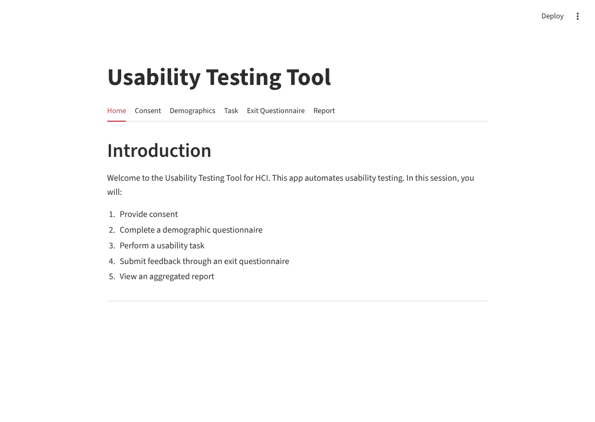
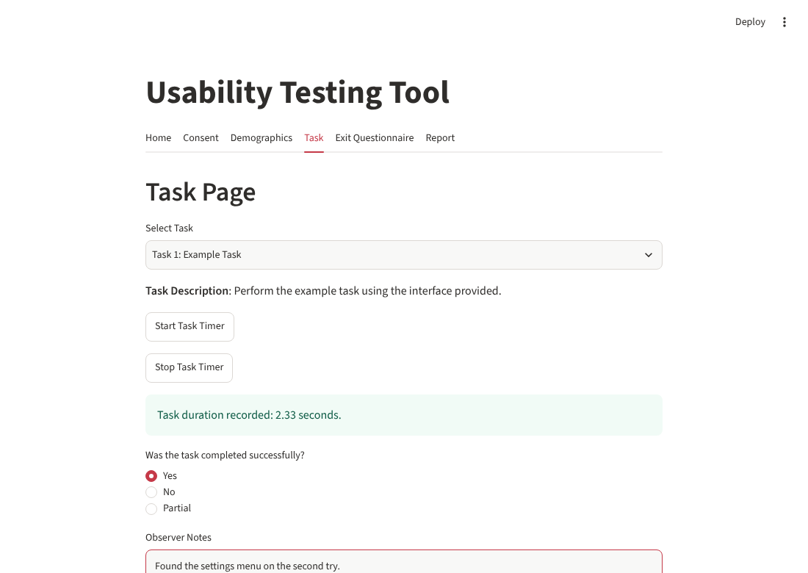
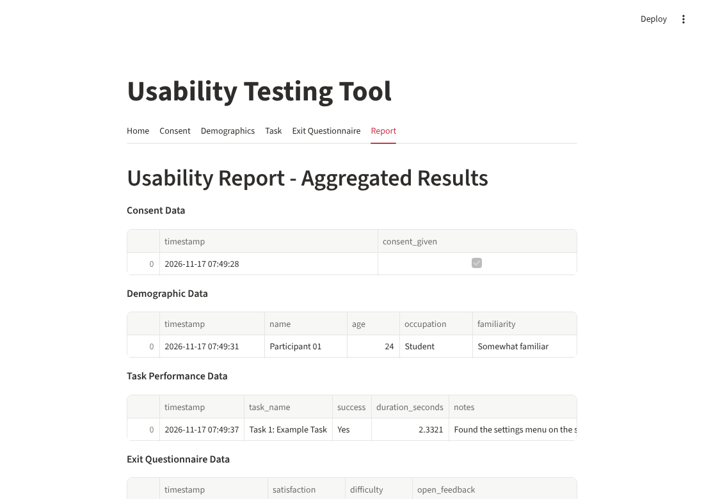

# Usability Testing Tool

[](https://github.com/al0n50/usability-testing-tool/actions/workflows/ci.yml)


[](LICENSE)

A Streamlit app that runs a complete usability test session in one place. A moderator walks a participant through consent, a demographic questionnaire, a timed task, and an exit questionnaire, and the app builds an aggregated report from every session.

Built for a Human-Computer Interaction (HCI) course to replace paper forms and stopwatches with a single repeatable workflow.



## Features

| Step | What it does |
|---|---|
| **Consent** | Records informed consent with a timestamp; the session can't be logged without it |
| **Demographics** | Captures name, age, occupation, and familiarity with usability testing |
| **Task** | Start/stop timer measures task duration; the observer marks success (Yes / No / Partial) and adds notes |
| **Exit questionnaire** | 1–5 satisfaction and difficulty ratings plus open feedback |
| **Report** | Shows every session in tables and computes average satisfaction and difficulty |

| Timed task | Aggregated report |
|---|---|
|  |  |

## How it works

- **UI:** Streamlit tabs and forms (`project1.py`); timer state lives in `st.session_state` between reruns.
- **Storage:** each step appends one row to its own CSV in `data/` (`consent_data.csv`, `demographic_data.csv`, `task_data.csv`, `exit_data.csv`). Headers are written once, on the first row.
- **Reporting:** the Report tab loads the CSVs with pandas and summarizes them.
- **Privacy:** `data/` is git-ignored, so participant responses never end up in the repository.

## Run it locally

```bash
pip install -r requirements.txt
streamlit run project1.py
```

Then open http://localhost:8501.

## Tests

```bash
pip install pytest
python -m pytest
```

The tests use Streamlit's `AppTest` to render the app headlessly. They check that all six tabs load, that consent can't be submitted without the checkbox, and that the CSV helpers append rows without repeating the header. GitHub Actions runs them on every push.

## License

[MIT](LICENSE) © 2025 Alonso Ochoa
